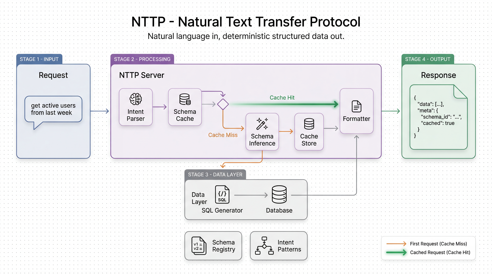

# NTTP (Natural Text Transfer Protocol)

Replace traditional API development with natural language requests that return structured, schema-consistent data.

## Overview

NTTP accepts plain text queries and returns structured data with automatically inferred and cached schemas for consistency. Built with **Anthropic's Structured Outputs** for guaranteed schema compliance and zero JSON parsing errors.

```bash
# Example query
curl -X POST http://localhost:8000/query \
  -H "Content-Type: application/json" \
  -d '{"query": "get all active users who signed up this month"}'
```

## Quick Start

### 1. Install Dependencies

```bash
pip install -r requirements.txt
```

### 2. Configure Environment

```bash
cp .env.example .env
# Edit .env and add your ANTHROPIC_API_KEY
```

### 3. Initialize Database

```bash
python scripts/seed_db.py
```

### 4. Run Server

```bash
uvicorn app.main:app --reload
```

### 5. Try It Out

Visit `http://localhost:8000/docs` for interactive API documentation.

## Architecture



### Flow

```
HTTP Request → Intent Parser (LLM) → Cache Lookup → [hit: format] / [miss: SQL Gen → Execute → Infer Schema → Cache]
```

## API Endpoints

- `POST /query` - Execute natural language query
- `GET /schemas` - List cached schemas
- `GET /schemas/{schema_id}` - Get specific schema
- `POST /explain` - Explain query without executing
- `GET /intents` - List known intent patterns

## Features

### Core Capabilities
- **Natural Language Queries**: No need to write SQL or API calls
- **Schema Inference**: Response structure automatically determined on first request
- **Schema Caching**: Consistent responses for similar queries (sub-50ms cache hits)
- **Type Safety**: Pydantic models throughout
- **Read-Only**: Safe, SELECT-only queries

### Reliability & Performance
- **🎯 Structured Outputs**: Uses Anthropic's beta feature for guaranteed schema compliance
  - **Zero JSON parsing errors**: Responses always match schema
  - **Type-safe guarantees**: No more missing fields or wrong types
  - **Automatic validation**: No retries needed for schema violations
- **⚡ Grammar Caching**: First-query compilation, then sub-50ms cache hits
- **🔒 Production-Ready**: Comprehensive error handling and logging

## Success Criteria

- [x] Natural language query interface
- [x] Automatic schema inference and caching
- [x] Sub-50ms cache hit latency
- [x] Schema management endpoints
- [x] Comprehensive test coverage

## Tech Stack

- **FastAPI**: Async web framework
- **SQLite + aiosqlite**: Embedded database
- **Claude API (Sonnet 4.5)**: Intent parsing and SQL generation with structured outputs
- **Pydantic**: Data validation
- **Structured Outputs Beta**: Guaranteed schema compliance (no JSON parsing errors)

## Documentation

- **[QUICKSTART.md](QUICKSTART.md)**: 5-minute getting started guide
- **[IMPLEMENTATION_SUMMARY.md](IMPLEMENTATION_SUMMARY.md)**: Complete implementation details
- **[STRUCTURED_OUTPUTS_UPGRADE.md](STRUCTURED_OUTPUTS_UPGRADE.md)**: Structured outputs feature guide
- **[UPGRADE_SUMMARY.md](UPGRADE_SUMMARY.md)**: Quick upgrade overview
- **/docs**: Interactive API documentation (http://localhost:8000/docs when server running)

## License

MIT
